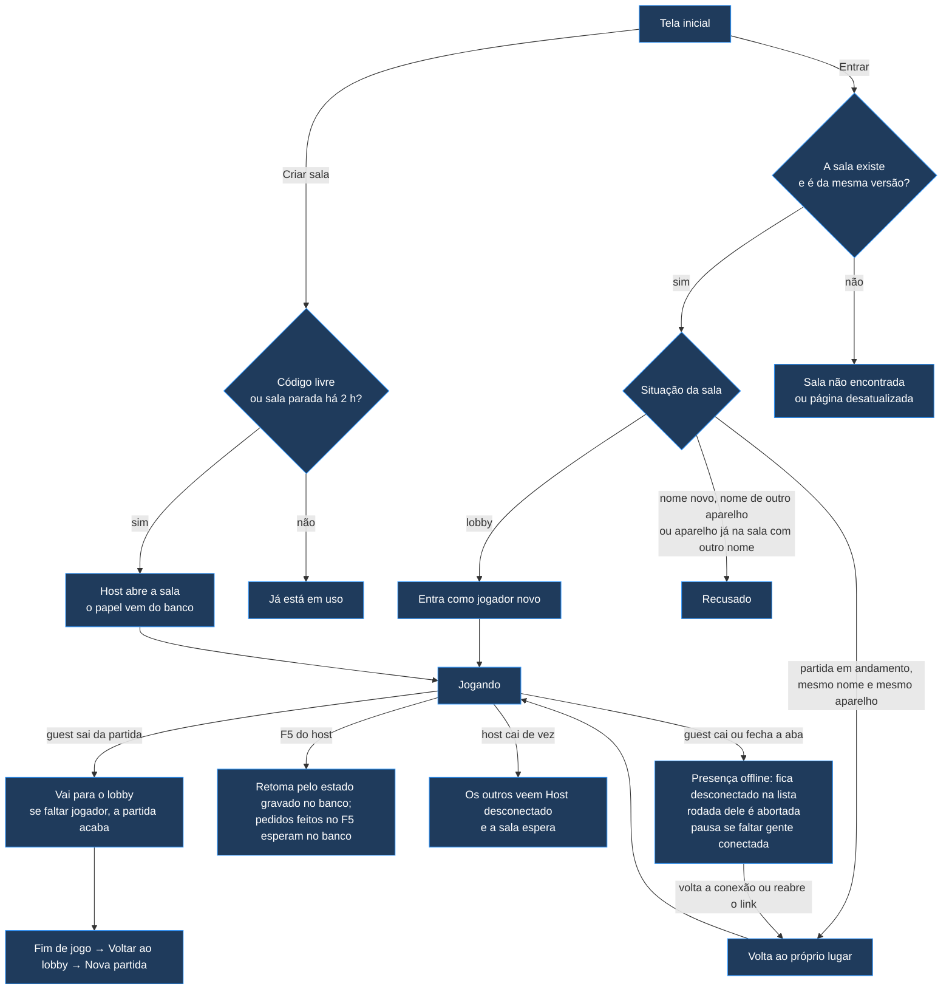

# Testes de conexão — o que está coberto e o que falta

> **Contém:** o checklist dos casos de conexão do jogo (entrada, queda,
> volta, F5, host que cai), cada um com os testes que o cobrem (`T`
> lógica, `E` navegador, `M` manual) e a prioridade P1/P2; limitações
> aceitas; o mapa dos cenários de `tests/browser`. **Não contém:** o passo
> a passo dos manuais (→ `manual-test-scripts.md`) nem a causa dos bugs
> (→ `issues.md`).

Serve de checklist antes de cada deploy: nenhum item marcado **P1** pode
ficar pendente.

**Legenda**

| Marca | Significado |
|---|---|
| 🤖 | Coberto por teste automatizado de lógica (`tests/logic`, roda no GitHub Actions a cada push) |
| 🌐 | Coberto por teste de ponta a ponta (`tests/browser`, jogo de verdade no Chromium, roda no GitHub Actions a cada push) |
| 👤 | Conferido em teste manual (navegadores reais, GitHub Pages) |
| ⬜ | Falta testar manualmente |
| 🐛 | Bug encontrado, ainda não corrigido |
| ⚠️ | Limitação conhecida (comportamento aceito por ora) |
| **P1** | Obrigatório antes do deploy · **P2** desejável |

> O jogo conversa pelo canal da sala no Firebase (`architecture.md`,
> seção "Conexão, identidade e F5"). Os testes de `tests/logic` garantem a
> **lógica** do jogo em cada situação, com a rede simulada; o
> `room-link.test.js` roda o canal e a ligação reais contra um banco
> simulado (`fakeFirebase.js`). Os de ponta a ponta (`tests/browser`)
> rodam o jogo de verdade em janelas separadas do Chromium, contra o
> emulador do Firebase — cobrem a conexão, mas não redes reais
> diferentes, celular nem outros navegadores. Esses continuam na lista
> manual.
>
> **Troca de host desligada até a etapa 3 do roadmap 2.9:** se o host
> cai, os outros veem "Host desconectado" e a sala espera por ele. Os
> testes da troca de host voltam com o mecanismo novo.

---

## 1. Fluxo geral

Cor: **azul** = automatizado (os manuais sobre o Firebase estão na seção 4).

---

## 2. Casos cobertos por teste automatizado

### Entrada na sala e identidade
| Caso | Testes | Manual |
|---|---|---|
| Lobby: guest que cai sai da lista e do roster | 🤖 T1, T170, T175 | — |
| Partida em andamento: nome novo recusado | 🤖 T2, T9, T169 · 🌐 E6 | 👤 (nome com maiúsculas diferentes foi recusado) |
| Nome em uso por quem está conectado continua bloqueado | 🤖 T3, T173 | — |
| Nome do próprio host recusado, host não perde o lugar | 🤖 T3b | — |
| Identidade pelo uid do login anônimo: mesmo nome e mesmo aparelho volta ao lugar; o nome de quem caiu em outro aparelho é recusado (`identity-mismatch`) e a vaga continua reservada | 🤖 T175 · 🌐 E27 | ⬜ |
| Aparelho já na sala com outro nome recusado (`device-in-use`) | 🤖 T176 | — |
| Quem é recusado não entra no roster, não lê a partida e volta à tela inicial | 🤖 T169, T175 | — |
| Jogo de outra versão (logo depois de um deploy) é recusado antes de tudo, com aviso para recarregar; quem caiu continua com a vaga reservada e volta depois de recarregar | 🤖 T76, T77, T80, T83, T86, T169, T177 | — |
| Sala inexistente: o jogo não pede nada e volta à tela inicial | 🤖 T169 | — |
| Criar sala com código de sala aberta: "já está em uso" em até 3s; código livre é aceito | 🤖 T167 · 🌐 E13 | ⬜ |
| Sala aberta em outra aba do mesmo navegador: a segunda aba não entra (aviso próprio) e não mexe na sala | 🤖 T173 | ⬜ |
| Login anônimo (emulador nos testes), uid e hora do servidor; falha do login vira erro | 🤖 T174 | — |

### Queda e volta de guest
| Caso | Testes | Manual |
|---|---|---|
| Queda vista pela presença: no lobby, sai da lista; na partida, fica desconectado com a vaga reservada | 🤖 T170 | — |
| Espectador cai: fica na lista, fora do sorteio, volta com tudo | 🤖 T4 | — |
| Quem caiu não pode ser chamado como assessor nem para ajudar (recusa na hora; quem pede chama outro); quem foi chamado e cai antes de responder libera quem responde no fim do prazo (`ADVISORY_TIMEOUT`) | 🤖 T70, T119, T122 | — |
| Participante da rodada cai: rodada abortada, nova dupla | 🤖 T5 | — |
| Falta só conexão: partida pausa e retoma com o mesmo evento | 🤖 T6, T33 | — |
| Ciclo da rodada termina sem esperar o desconectado | 🤖 T8 | — |
| Volta da conexão: o guest manda o player-join de novo e retoma o lugar; nenhum aviso de antes do estado chega depois dele | 🤖 T171 | ⬜ (M7) |
| Quem entra ou volta recebe o estado com o cursor dos avisos: nada de antes dele, os de depois uma vez, na ordem | 🤖 T168, T177 | — |
| O estado de quem entra ou volta não leva os baralhos nem a resposta que espera o apoio; o gabarito da pergunta da vez só vai para o Perguntador (SEC-005) | 🤖 T79, T80, T186 | — |
| F5 de guest: volta ao mesmo lugar pelo uid | 🤖 T171 · 🌐 E6 | — |
| Guest volta com o relógio andando e sem reabrir pergunta já respondida | 🤖 T30–T34 | — |
| Relógio e prazos pela hora do servidor: todos mostram o mesmo tempo, mesmo com o relógio do aparelho errado; quem volta à pergunta vê o que falta do prazo, não o prazo inteiro | 🤖 T179–T182 · 🌐 E28 | — |
| Sala cheia: 7º nome recusado no lobby; quem caiu consegue voltar | 🤖 T9 · 🌐 E16 | — (coberto por E16) |

### Host: F5 e queda
| Caso | Testes | Manual |
|---|---|---|
| Host cai: os outros veem "Host desconectado"; ninguém assume; com o host de volta, "Conectado" | 🤖 T172 | ⬜ |
| F5 do host: continua host pelo meta da sala e volta com o estado da partida gravado no banco (`secret/state`, lido antes de montar a tela); os pedidos feitos durante o F5 esperam no banco e são tratados depois da retomada; quem ficou na sala pede o estado de novo quando o host volta | 🤖 T172, T184, T185 · 🌐 E1, E9 | — (coberto por E1) |
| F5 do host com a pergunta aberta: a mesma pergunta continua; relógio e prazo de resposta continuam de onde estavam; prazo vencido durante o F5 tem o efeito na retomada | 🤖 T56, T182 · 🌐 E1, E28 | ⬜ (contador da tela do host que responde, depois do F5 dele) |
| Pergunta ainda por fazer (o Perguntador não clicou em "Fazer a pergunta"): no F5 do host e na volta à partida, a rodada continua esperando o clique, com o prazo do Perguntador continuando de onde estava (vencido: a pergunta vai na retomada); quem volta como Respondedor vê o aviso, não as alternativas | 🤖 T138, T139, T181 | — |
| F5 do host fora da dupla com a pergunta aberta: o host vê a tela de espectador; etiquetas de domínio e área aparecem depois do F5 e para quem volta (BUG-020) | 🤖 T64, T65 | — |
| F5 do host com a rodada encerrada: continua encerrada para todos, nada começa sozinho | 🤖 T53, T57 · 🌐 E9 | — (coberto por E9) |
| F5 do host logo depois de uma resposta: segue para a próxima dupla ou encerra a rodada; se a resposta completou a última área foco, a partida termina | 🤖 T54, T58 · 🌐 E10 | — (coberto por E10) |
| F5 do host com a partida pausada: continua pausada com o mesmo evento e retoma quando alguém volta | 🤖 T55, T57 · 🌐 E11 | — (coberto por E11) |
| F5 do host com um pedido de assessoria ou de ajuda sem resposta: o pedido continua, com o prazo que faltava a quem foi chamado (vencido durante o F5: recusa por tempo na retomada), e o prazo de quem pediu continua parado até o apoio terminar; quem foi chamado recebe a pergunta do apoio de novo (o host chamado a vê na retomada) e a resposta dele vale depois do F5; apoio já respondido continua valendo (com o honorário, a recompensa ou a cobertura) (BUG-019) | 🤖 T59, T60, T122, T187 · 🌐 E29 | — (coberto por E29) |
| F5 do host logo depois de o jogo ser atualizado (estado salvo pela versão anterior): o estado é migrado e a partida continua de onde estava (pergunta aberta, pausa, rodada encerrada); recursos, área foco e ranking final dos jogadores e a assessoria da rodada (pendente, sugestão ou recusa continuam) chegam iguais; os campos da conexão antiga saem; o tempo que faltava vira a hora de término da partida | 🤖 T78, T79, T81, T82, T84, T85, T125, T178, T183 | — |
| Todos recebem quem já respondeu na rodada (resposta, nova dupla, volta) | 🤖 T49 | — |
| Sair da sala: o guest para de ouvir; o host apaga a sala | 🤖 T174 | — |

### Fim de partida e lobby
| Caso | Testes | Manual |
|---|---|---|
| Fim de jogo: quem cai sai da lista | 🤖 T11 | — |
| Fim de jogo, encerrar a partida e troca de dupla cancelam os prazos pendentes (resposta e assessoria ou ajuda) | 🤖 T72 | — |
| F5 na tela de fim de jogo (host e guest) volta à tela final com o mesmo ranking, sem recomeçar a partida; quem cai no fim de jogo pode voltar à sala e vê o ranking (BUG-021) | 🤖 T66, T67, T68 | — |
| Encerrar partida (normal e pausada) | 🤖 T14, T15 | — |
| Voltar ao lobby após o fim de jogo (host e guest) | 🤖 T16, T16b | — |
| Guest sai da partida, ela acaba, e o host inicia outra | 🤖 T48 · 🌐 E8 | 👤 |
| Pausa retomada com todos os conectados já tendo respondido: rodada encerra em vez de recomeçar | 🤖 T52 | — |
| Sair da partida: se faltar jogador, a partida acaba | 🤖 T7 | 👤 |
| Todos saem e o host reabre a sala: a partida é restaurada enquanto a sala existir, sem prazo de validade (pausada, com o mesmo evento); estado de versão mais nova, inválido ou ilegível não é restaurado e fica no banco | 🤖 T62, T185 · 🌐 E17 | — (coberto por E17) |

---

## 3. Bugs encontrados, ainda não corrigidos

Nenhum no momento. Os bugs encontrados nestes testes e já corrigidos
(B1–B5 = BUG-014 a BUG-018, e BUG-019 a BUG-023) estão em `issues.md`,
com sintoma, causa e correção.

---

## 4. Falta testar manualmente

Cada teste com navegadores **diferentes** (não duas abas do mesmo
navegador — elas compartilham o login, e a segunda aba
não entra na sala) e com as janelas visíveis lado a lado (aba em segundo
plano fica mais lenta).

| # | Prioridade | Caso | Como testar | Esperado |
|---|---|---|---|---|
| M1 | ✅ 🌐 E1 | F5 do host no meio de uma pergunta | Host dá F5 com a pergunta aberta | Guests continuam ligados, sem troca de host; a partida segue |
| M2 | ✅ 🌐 E9 | F5 do host com "rodada encerrada" | Host dá F5 esperando o "Nova Rodada" | Continua "Rodada encerrada" para todos, esperando o clique |
| M6 | ✅ 🌐 E6 | Guest cai e volta | Guest dá F5 no meio da própria pergunta; outro guest fecha e volta pela tela inicial | Voltam ao próprio lugar, com KPI; rodada tratada como nos testes T5/T34 |
| M7 | **P1** | Queda de rede real (não fechar aba) | Roteiro novo sobre o Firebase na etapa 4 do roadmap 2.9 (o de `manual-test-scripts.md` é da conexão antiga) | Guest: volta sozinho quando a rede volta. Host: os outros veem "Host desconectado" e a sala espera |
| M8 | **P1** | Celular com tela bloqueada / navegador em segundo plano | Roteiro novo sobre o Firebase na etapa 4 do roadmap 2.9 | Ao desbloquear, volta à partida |
| M9 | — | Redes diferentes (conexão direta entre navegadores) | — | Sem efeito com o Firebase (não há conexão direta); a rede de cada lugar é conferida pelo M21. Como fechar a Fase D se decide na fase do Firebase |
| M10 | ✅ 🌐 E8 | Nova partida depois de "saiu da partida" | 2 jogadores; guest sai; host volta ao lobby e inicia outra | Conferido em 30/09/2026 |
| M13 | ✅ 🌐 E17 | Host sai com a partida pausada | Guest cai (a partida pausa), depois o host fecha a aba e a reabre | Continua pausada com o mesmo evento e retoma quando o guest volta |
| M14 | ✅ 🌐 E13 | Criar sala com código em uso | Código de sala aberta | "Já está em uso", em até 3s |
| M15 | ✅ 🌐 E16 | Sala cheia (6 jogadores) | 6 navegadores/dispositivos; 1 cai e volta | Volta ao lugar; 7º nome é recusado |
| M16 | ✅ 🌐 E17 | Reusar o código depois que todos saem | Todos fecham; o host reabre (em 1 min ou depois de mais tempo) | A partida é restaurada enquanto a sala existir, sem prazo de validade |
| M17 | P2 | Navegadores | Chrome, Edge (inclusive InPrivate), Firefox, Safari no iPhone | Mesmo comportamento |
| M18 | P2 | Aba em segundo plano por muito tempo | Deixar a aba escondida 10 min | Ao voltar, o jogo se recupera (pode precisar de F5) |
| M21 | **P1** (roadmap 2.9) | Teste de conexão pelo Firebase em redes reais | Roteiro M21 de `manual-test-scripts.md` (em casa: computador no Wi-Fi e celular nos dados móveis; na instituição: celular no 5G e computador na rede dela), na página `firebase-check.html` | Cria, entra, troca mensagens (com o tempo de ida e volta), volta sozinho depois do F5 e do modo avião (lógica coberta por 🤖 T143–T153 e 🌐 E24, E25). **Em casa ✅ 👤 (17/10/2026, computador no Wi-Fi e celular no 4G):** todos os passos; ida e volta de 382–434 ms; volta em 1–2 s depois do modo avião e na hora depois da tela bloqueada. O servidor tira da lista quem cai sem aviso em ~2 min (modo avião) e em menos de 1 min (tela bloqueada). **Falta a parte na instituição.** |

Os manuais da troca de host (M3, M4, M5, M11, M12, M19, M20) ficam
suspensos até a etapa 3 do roadmap 2.9, que traz a troca de host pelo
banco.

---

## 5. Limitações conhecidas (aceitas por ora)

- ⚠️ Sem troca de host até a etapa 3 do roadmap 2.9: se o host cai de vez, a sala espera por ele.
- ⚠️ Sinal de vida mínimo até a etapa 3: o host vê a queda quando o servidor do Firebase percebe a conexão fechada — na hora quando a aba fecha; até ~2 min numa queda de rede sem aviso. Uma queda percebida tarde pode marcar como desconectado quem já voltou (até a próxima queda e volta dele).
- ⚠️ Nomes diferenciam maiúsculas: "vHost" e "Vhost" são jogadores diferentes — durante a partida, a grafia errada é recusada. Melhoria futura (roadmap 8.5).
- ⚠️ Abas do mesmo navegador compartilham o login (uid): a segunda aba com a mesma sala não entra. Trocar de navegador, usar aba anônima ou limpar os dados no meio da partida perde a identidade (só volta no lobby).
- ⚠️ As respostas não são secretas: `data/questions.pt-BR.json` é público no site (o `state-sync` não leva mais os baralhos, SEC-005, mas o arquivo continua aberto). Ocultar é melhoria futura (roadmap 4.4); por ora, vale a regra da aula.
- ⚠️ A lista "Em jogo" da tela de espera do lobby (`showLobbyWaitingView`) não mostra os jogadores desconectados.
- ⚠️ Diferença de ~1s entre o relógio do host e o dos guests que voltam.
- ⚠️ Dependem da internet dos domínios do Google (`gstatic.com`, `firebaseio.com`) e do limite de 100 aparelhos ao mesmo tempo do plano gratuito do Firebase.
- ⚠️ **Em investigação:** travamentos do Edge no Windows (uma vez travou o computador inteiro; outra, ~5s ao criar sala). Reproduzindo o mesmo cenário no Chromium (mesmo motor do Edge), a página não travou: nenhuma tarefa acima de 100 ms, e memória e elementos da página estáveis durante a partida. Falta medir no próprio Edge (Gerenciador de Tarefas do navegador, Shift+Esc) e comparar com o Chrome na mesma máquina.

---

## 6. Testes de ponta a ponta (`tests/browser`)

O jogo de verdade, em janelas separadas do Chromium (cada uma com
armazenamento e login próprios, como navegadores diferentes), com o site
e o emulador do Firebase (login e banco, com as regras de
`database.rules.json`) locais, dentro do GitHub Actions. Só os arquivos
do Firebase (gstatic.com) vêm da internet. Os arquivos do jogo não mudam:
o teste só aponta o Firebase para o emulador.

| # | Cenário | Cobre |
|---|---|---|
| E1 | F5 do host no meio da pergunta: o outro continua ligado ao mesmo host, sem troca de host; a rodada vai até o fim | M1 |
| E6 | Jogador dá F5; outro fecha e volta pela tela inicial; nome novo é recusado; a rodada vai até o fim | M6 |
| E8 | Jogador sai da partida, ela acaba; voltar ao lobby e iniciar outra | M10 |
| E9 | F5 do host com a rodada encerrada: continua encerrada para os dois, "Nova Rodada" liberado, nada começa sozinho | M2, B3 |
| E10 | F5 do host logo depois de responder: a partida segue (próxima dupla ou fim da rodada) e a rodada seguinte começa | B4 |
| E11 | F5 do host com a partida pausada: continua pausada com o mesmo evento, sem mostrar outro; retoma quando o outro volta | B5 |
| E13 | Criar sala pela tela inicial com o código de uma sala aberta: "já está em uso" em até 3s, sem derrubar ninguém; código livre chega a "Sala criada" | M14 |
| E16 | 6 jogadores: o 7º é recusado no lobby ("Sala cheia"); com a partida em andamento, um cai e volta ao próprio lugar | M15 |
| E17 | Guest sai (pausa), depois o host; o host reabre: continua pausada com o mesmo evento, sem mostrar outro; retoma quando o guest volta | M13, M16 |
| E19 | 3 jogadores; o guest que responde está sem recursos, pede ajuda ao colega fora da dupla, que sugere a certa; seguindo, ele acerta sem mexer nos recursos e quem ajudou ganha a recompensa e vê o aviso | — |
| E20 | Janela de 1000 px com o card do jogador em estouro (−12): os chips de KPI e de recursos ficam dentro do card | BUG-025 (layout) |
| E21 | Celular baixo (375×480) com a pergunta aberta: a janela de resposta cabe na tela e rola até a última alternativa | BUG-026 (layout) |
| E22 | Celular (375 px) no fim de partida: o detalhe de cada jogador no ranking fica abaixo do nome | BUG-027 (layout) |
| E23 | Quem responde vê o aviso de quem vai perguntar, sem a janela de resposta; o Perguntador clica em "Fazer a pergunta" e a janela abre com o prazo inteiro | — (etapa "Fazer a pergunta") |
| E24 | Página de teste de conexão: sala inexistente recusada; criar, entrar, mensagem de teste com eco e tempo; F5 volta sozinho à sala; quem fecha a aba sai da lista | M21 (a parte que não depende da rede real) |
| E25 | Regras do banco no emulador: sem login não lê; fora da sala, sala de outro, aparelho de outro, mensagem em nome de outro e conteúdo grande demais são recusados; ler a sala e gravar o próprio aparelho e a própria mensagem passam | — (segurança do banco) |
| E26 | Regras do banco para as salas do jogo (`rooms/`): o host grava tudo; quem foi aceito lê o estado público e o próprio, nunca o secreto, e não grava o que é do host; quem não foi aceito só lê a sala, a própria caixa de avisos e manda pedido em nome próprio; presença: cada um grava só a própria (estando no roster ou sendo o host), o host lê todas e quem foi aceito só a do host; sala parada há 2 h pode ser criada de novo por outro, e o host antigo perde o acesso | — (segurança do banco; lógica do canal em 🤖 T154–T166) |
| E27 | Outro navegador com o nome de quem caiu é recusado e a vaga continua reservada; o dono volta ao lugar pelo mesmo navegador, com KPI e recursos | — |
| E28 | Um navegador com o relógio 30 s adiantado (`page.clock`) mostra o mesmo tempo do host; o F5 do host ~12 s depois do início continua o relógio do mesmo ponto | — (relógio pela hora do servidor) |
| E29 | 3 jogadores; um guest pede apoio, quem foi chamado não responde e o host dá F5: o pedido continua pendente (quem pediu segue com os botões travados), quem foi chamado vê a pergunta do apoio de novo e responde, quem pediu recebe a sugestão, responde e a rodada segue | BUG-019 |

Números retirados (não se reaproveitam): E12 (o apoio pendente era
cancelado no F5 do host; o E29 confere o comportamento atual) e E18 (a
partida só era restaurada até 5 min depois de todos saírem; hoje vale
enquanto a sala existir).

**Continuam manuais:** M7 (queda de rede real), M8 (celular), M21 (redes
reais), M17 (Firefox, Safari) e M18 (aba esquecida em segundo plano).

Rodar localmente (precisa de Node e de Java 21 para o emulador): `npm ci`,
`npx playwright install chromium`, `npm install -g firebase-tools@15.32.1`
e `npx playwright test --config tests/browser/playwright.config.js`.
